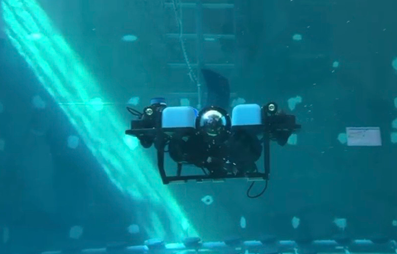
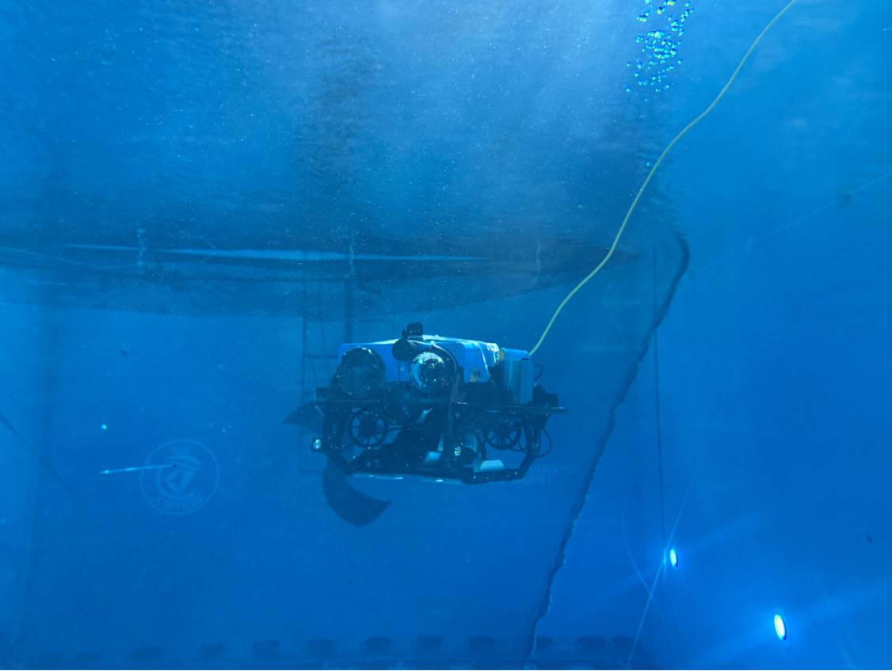
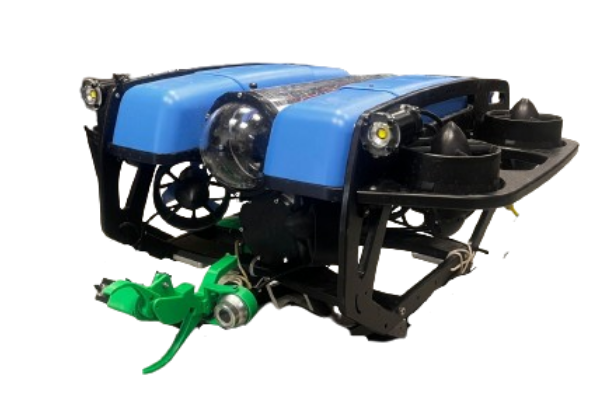
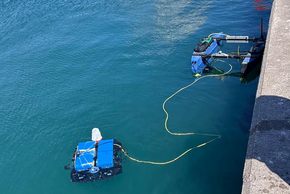
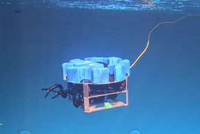

Real Robot Integrations
=======================

SURA has been used on physical surface and underwater robots, from commercial
vehicles to custom-built platforms. These integrations demonstrate how the
same architecture can accommodate different sensors, onboard computers,
actuators and vehicle configurations.

BlueROV and Custom Variants
---------------------------

SURA has been tested on a BlueROV and a **custom BlueROV (blueGROS)**. The
modular architecture made it straightforward to integrate
additional hardware, including a ZED X Mini stereo camera, a DVL, extra
cameras, a Ping sonar and an additional onboard computer such as a Jetson.
Robot-specific descriptions and interfaces connect these devices to the
shared software components.

   BlueROV during an underwater test.

   Custom BlueROV (blueGROS) during tank testing.

Another custom BlueROV configuration adds motors to drive a **zip-tie tool**.
This illustrates how the same platform can be extended with task-specific
actuators.

   BlueROV configuration with the zip-tie tool.

Surface and Multi-Robot Operation
---------------------------------

SURA has also been tested on the **BlueBoat** surface vehicle. In a
multi-robot setup, a BlueBoat and a BlueROV were operated together, showing
that the architecture can be used across surface and underwater platforms in
the same deployment.

   BlueBoat and BlueROV in a multi-robot test.

Custom AUV / UVDMS
------------------

SURA has also been integrated into our **custom AUV / UVDMS**, equipped with
two Reach Alpha arms. This extends the architecture to a vehicle with dual
manipulators as well as propulsion and sensing hardware.

   Custom AUV / UVDMS during an underwater test.

Testing Environments
--------------------

The integrations have been tested both in a controlled water tank and in
operational environments such as a harbor. These trials exercised the robots
with different hardware configurations and in different water conditions.
