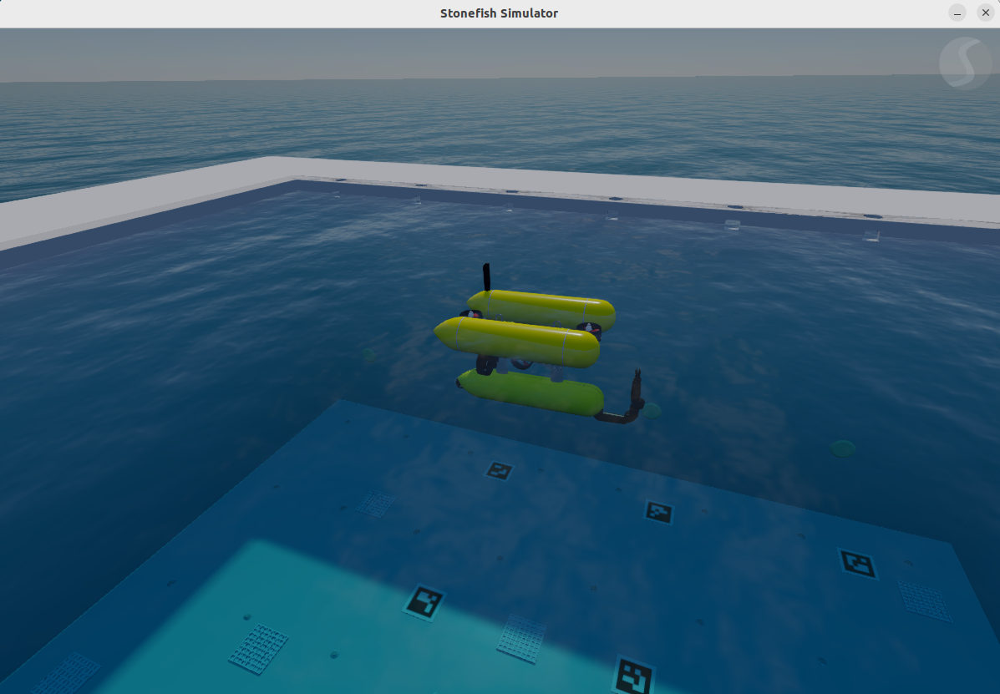

Simulation Installation and Setup
=================================

This guide explains how to install and set up the
`Stonefish <https://stonefish.readthedocs.io/en/latest/>`_ simulation environment
for SURA using Docker. It then shows how to launch a simulated robot, SURA and
the teleoperation tools so you can test the robot before using real hardware.

Before starting, install Docker and the NVIDIA container runtime on a computer
with an NVIDIA GPU.

Create a Simulation Folder
--------------------------

First create a folder for the simulation files and enter it:

.. code-block:: bash

   mkdir -p sura_simulation
   cd sura_simulation

Create the Docker Compose File
------------------------------

Create the ``docker-compose.yml`` file inside the ``sura_simulation`` folder:

.. code-block:: bash

   nano docker-compose.yml

Paste this content:

.. code-block:: yaml

   services:
     sura_stonefish:
       build:
         context: .
         dockerfile: Dockerfile.girona500
       image: inesperez03/sura-stonefish-ros2-humble:girona500
       container_name: sura_stonefish

       network_mode: host
       ipc: host

       stdin_open: true
       tty: true

       environment:
         NVIDIA_DRIVER_CAPABILITIES: all
         DISPLAY: ${DISPLAY}
         XDG_RUNTIME_DIR: /tmp/runtime-root
         SDL_VIDEODRIVER: x11
         ROS_DOMAIN_ID: 4
         RMW_IMPLEMENTATION: rmw_cyclonedds_cpp

       volumes:
         - /tmp/.X11-unix:/tmp/.X11-unix:rw
         - /dev/input:/dev/input

       device_cgroup_rules:
         - "c 13:* rmw"

       deploy:
         resources:
           reservations:
             devices:
               - driver: nvidia
                 count: all
                 capabilities: [gpu]

       command:
         - bash
         - -lc
         - |
           set -e
           if [ ! -d /root/sura_ws_meta ]; then
             git clone https://github.com/sura-framework/sura_ws_meta.git /root/sura_ws_meta
             cd /root/sura_ws_meta
             mkdir -p src
             vcs import src < workspace.repos
           fi
           cd /root/sura_ws_meta
           if [ ! -d src/bluerov_description ] ||
              [ ! -d src/girona500_description ] ||
              [ ! -d src/cirtesub_description ] ||
              [ ! -d src/blueboat_description ]; then
             if [ ! -d src/bluerov_description ]; then
               git clone https://github.com/sura-framework/bluerov_description.git src/bluerov_description
             fi
             if [ ! -d src/girona500_description ]; then
               git clone https://github.com/sura-framework/girona500_description.git src/girona500_description
             fi
             if [ ! -d src/cirtesub_description ]; then
               git clone --branch sim https://github.com/sura-framework/cirtesub_description.git src/cirtesub_description
             fi
             if [ ! -d src/blueboat_description ]; then
               git clone --branch bt https://github.com/Mariolopez31/blueboat_description.git src/blueboat_description
             fi
             source /opt/ros/humble/setup.bash
             colcon build
           fi
           sleep infinity

This example uses ``ROS_DOMAIN_ID=4`` and Cyclone DDS:

.. code-block:: yaml

   ROS_DOMAIN_ID: 4
   RMW_IMPLEMENTATION: rmw_cyclonedds_cpp

Start the Container
-------------------

Allow Docker to open graphical windows:

.. code-block:: bash

   xhost +si:localuser:root

Start the container:

.. code-block:: bash

   docker compose up -d

Check that it is running:

.. code-block:: bash

   docker ps

Open Terminals Inside Docker
----------------------------

Open three different terminals on the host. In each one, enter the container:

.. code-block:: bash

   docker exec -it sura_stonefish bash

Terminal 1: Launch the Simulation
---------------------------------

Inside the first Docker terminal, prepare the environment:

.. code-block:: bash

   cd /root
   source /opt/ros/humble/setup.bash
   source sura_ws_meta/install/setup.bash
   source stonefish_enviroments/install/setup.bash

Then launch one simulation. Use only one of these commands:

.. code-block:: bash

   ros2 launch bluerov_stonefish bluerov_cirtesu.launch.py

.. image:: _static/bluerov_stonefish.png
   :alt: BlueROV Stonefish simulation
   :width: 420px

.. code-block:: bash

   ros2 launch cirtesub_stonefish cirtesub_cirtesu.launch.py

.. image:: _static/cirtesub_stonefish.png
   :alt: CIRTESUB Stonefish simulation
   :width: 420px

.. code-block:: bash

   ros2 launch blueboat_stonefish blueboat_cirtesu.launch.py

.. image:: _static/blueboat_stonefish.png
   :alt: BlueBoat Stonefish simulation
   :width: 420px

.. code-block:: bash

   ros2 launch catamaran_stonefish catamaran_cirtesu.launch.py

.. image:: _static/catamaran_stonefish.png
   :alt: Catamaran Stonefish simulation
   :width: 420px

.. code-block:: bash

   ros2 launch girona500_stonefish girona500_cirtesu.launch.py

Terminal 2: Launch SURA
-----------------------

Inside the second Docker terminal, launch SURA. Replace ``robot_name`` with the
namespace for the robot that is running in Stonefish:

.. list-table::
   :header-rows: 1

   * - Simulation
     - ``robot_name``
   * - BlueROV
     - ``bluerov``
   * - CIRTESUB
     - ``cirtesub``
   * - BlueBoat
     - ``blueboat``
   * - Catamaran
     - ``catamaran``
   * - Girona500
     - ``girona500``

.. code-block:: bash

   cd /root
   source /opt/ros/humble/setup.bash
   source sura_ws_meta/install/setup.bash
   source stonefish_enviroments/install/setup.bash
   ros2 launch sura_bringup sura_bringup.launch.py robot_namespace:=robot_name

Terminal 3: Launch Teleoperation
--------------------------------

Inside the third Docker terminal, launch the ground control station. This starts
RViz and the joystick teleoperation tools from :doc:`packages/sura_teleop`:

.. code-block:: bash

   cd /root
   source /opt/ros/humble/setup.bash
   source sura_ws_meta/install/setup.bash
   source stonefish_enviroments/install/setup.bash
   ros2 launch sura_bringup sura_gcs.launch.py robot_namespace:=robot_name

.. image:: _static/rviz_teleoperation.png
   :alt: RViz ground control station for SURA teleoperation
   :width: 520px
